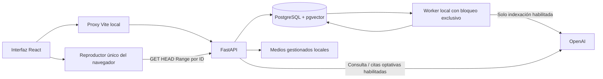

# Arquitectura implementada — P28

EchoBeats es el nombre definitivo; Dream Radio es el título histórico del concepto.
MVP local de un usuario, React/TypeScript/Vite + Python/FastAPI + PostgreSQL/pgvector.
Decisiones y alcance en DECISIONES.md/ALCANCE_MVP.md; no atribuir aprobación docente
de stack, VPS/tenants o PDF/OCR mientras siga pendiente en REVISION_REQUERIMIENTOS.md.

No hay broker externo: cola durable y worker local del backend, CAS por intento y
versión, bloqueo para un dueño, historial y publicación/finalización atómicas.
Preparar metadatos y indexar son operaciones distintas. Ni la UI ni el estado de
configuración se conectan directamente a OpenAI. Transacciones cerradas durante red
y nueva instantánea posterior para retirar fichas/filtros/referencias obsoletos.

## Catálogo, medios y personalización

- Importación valida contenido/límites, publica copia gestionada con nombre generado
  y conserva originales; duplicados por bytes exactos. Etiquetas nunca sobrescriben
  manuales ni reescriben audio. Portadas normalizadas y GIF con preview/límites.
- Almacenamiento privado fuera del cliente, API solo por IDs. Audio GET/HEAD/Range
  con MIME real; imagen regular/tamaño/acceso comprobados y errores sin rutas.
- Catálogo paginado, créditos agrupados y filtros SQL parametrizados. P27 limita
  la página de pistas/álbumes a cuatro sentencias con fixture de 24 elementos.
- Playlists guardan orden/revisión/imagen; muro por álbum con versión, geometría,
  capas y recursos; ETags evitan sobreescrituras. Autoguardado serializado conserva
  cambios nuevos en vuelo. Quitar/reset no borra archivos registrados compartidos.
- Un audio en navegador, cola en memoria, sin reproducción automática al recargar.
  Favoritos explícitos persistidos, sin escucha implícita ni gustos desde el muro.

## Recuperación y razones

Una ficha actual y sus revisiones conservan fuente, texto, atributos/evidencia y hash.
Un embedding 1536 enlaza versión/hash/espacio/receta. El índice no vuelve verdadera
una emoción ni acredita análisis acústico. pgvector hace coseno exacto, textual usa
FTS simple y híbrida fusiona rangos RRF(60); no ANN ni porcentajes de confianza.

Similares usa vector de referencia y la excluye. Sin umbral evaluado son candidatos.
Citas optativas seleccionan fragmentos literales ID/versión/subcadena; se descarta
prosa libre. Fallo conserva descripción registrada. P25 aplica ajuste optativo de
pares de candidatos, máximo una posición, o descubrir excluyendo favoritos antes
del límite. Cada resultado explica orden sin inventar atributos musicales.

## Operación y evidencia

Alembic 0001–0009; head 0009_favorites. Ready comprueba BD/extensión/revisión, no
proveedor. .env/volumen/medios/backups privados; dump lógico y copia de medios son
complementarios. Restaurar crea otra base. Dockerfiles/locks fijan dependencias;
backend nativo requiere Python 3.12 y frontend Node 24 de referencia.

Pruebas: capas unitarias/controladores, SQL/pgvector con proveedores simulados en
BD/medios temporales, HTTP con procesos nuevos P26 y arranque de otro proyecto P28.
Estas evidencias no acreditan éxito OpenAI real, audio audible, navegador/teclado,
WCAG ni preparación comercial. Matriz CA y hallazgos conservan su estado pendiente.
