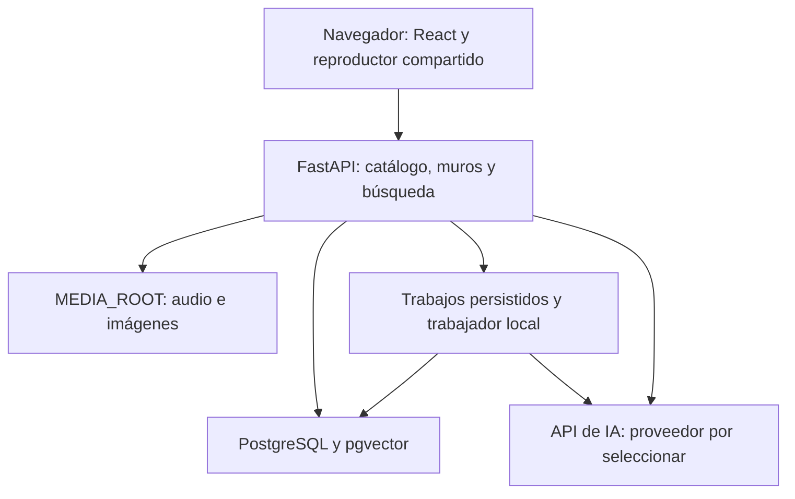

# Decisiones técnicas de EchoBeats

Fecha: 12 de noviembre de 2026. Entregable P02.
Estado: decisiones iniciales de trabajo para implementar P03 en adelante.
Son elecciones de diseño adoptadas en este paso, revisables con el usuario;
no se atribuyen a una aprobación docente ni a una aplicación ya probada.

Documentos relacionados: [alcance](ALCANCE_MVP.md), [pantallas](DISENO_PANTALLAS.md),
[modelo de datos](MODELO_DATOS.md) y [contrato de API](CONTRATO_API.md).

## D01 — Aplicación local de un solo usuario

El MVP funciona en el equipo del usuario, desde el navegador. Backend, frontend
de desarrollo y puertos publicados de BD escucharán en `127.0.0.1`. No se crean
registro, login, perfiles ni tablas de usuarios en esta entrega. La biblioteca
pertenece a una instalación local. No publicar estos servicios en una red abierta.

Esta decisión reduce el trabajo de cuentas sin cambiar la experiencia musical.
Publicar en un servidor o admitir varias personas requerirá una nueva decisión,
autenticación y propiedad de todos los recursos antes de exponerlos. La ausencia
de login es una condición del despliegue local, no una estrategia multiusuario.
Validar Host/origen de solicitudes de escritura y permitir solo el origen local
configurado; no usar CORS abierto como sustituto de control de acceso.

## D02 — Interfaz React, TypeScript y Vite

Usar React con TypeScript, HTML y CSS. Vite se utiliza para desarrollo y build.
El editor necesita estado de selección, transformaciones, guardado y navegación;
los componentes y contratos tipados permiten separar esas responsabilidades.
No se impone una biblioteca de componentes ni un framework CSS.

La raíz contiene `AppShell`, navegación, rutas de vistas y `PlayerProvider` con
un único elemento `audio`. El reproductor no se desmonta al cambiar de pantalla.
El estado musical se conserva en memoria durante la navegación; cerrar/reabrir
no inicia audio automáticamente. Una futura restauración de pista/posición no
forma parte de esta entrega. React documenta la gestión de estado compartido
en un ancestro común; aplicamos ese patrón al reproductor.
[Fuente oficial](https://react.dev/learn/sharing-state-between-components).

La documentación de Vite incluye la plantilla `react-ts`; los requisitos de Node
de la versión elegida se comprobarán al fijar dependencias en P03.
[Fuente oficial](https://vite.dev/guide/).

## D03 — Backend Python y API REST

Python 3.12 como base de ejecución en contenedor; FastAPI, Pydantic, SQLAlchemy,
Psycopg y Alembic para API, validación, acceso a datos y migraciones.
Usar sesiones/transacciones SQLAlchemy acotadas por operación; no compartir una
sesión entre peticiones o trabajos. El contrato usa JSON y multipart para archivos.
FastAPI admite cargas mediante `UploadFile` y formularios multipart.
[Archivos en FastAPI](https://fastapi.tiangolo.com/tutorial/request-files/).
SQLAlchemy documenta el ciclo de sesión/transacción y Alembic las migraciones.
[Sesiones](https://docs.sqlalchemy.org/en/20/orm/session_basics.html),
[Alembic](https://alembic.sqlalchemy.org/en/latest/).

Entorno observado en esta sesión: Python 3.10.12, Node 25.2.1 y Docker 25.0.3.
No se instalaron dependencias. Para evitar modificar el Python del sistema, P03
preparará ejecución de backend con Docker y comprobará disponibilidad de Compose.
También podrá usarse un entorno virtual si ya existe Python compatible.
Las versiones exactas y archivos de bloqueo se fijan y prueban en P03; este
documento no declara compatible una combinación que no se ha instalado.

## D04 — Entorno y organización

Docker Compose organizará backend, frontend de desarrollo y PostgreSQL. La
imagen de BD debe incluir pgvector; la extensión se activa mediante migración.
Se propone PostgreSQL 17 como base de trabajo, con etiqueta/digest concreta de
imagen verificada al preparar P04. El repositorio oficial de pgvector describe
instalación, activación y opciones Docker.
[Fuente oficial](https://github.com/pgvector/pgvector).

```text
frontend/src/
  app/                 navegación y reproductor compartido
  features/            library, import, playlists, player, walls, explore
  shared/              API, tipos y controles comunes
backend/
  app/api/             rutas y esquemas de entrada/salida
  app/services/        casos de uso y transacciones
  app/models/          persistencia
  app/integrations/    archivos, metadatos, IA
  migrations/          Alembic
  tests/               lógica e integración
docs/                  especificación y decisiones
pruebas/coleccion/     fixtures sintéticos explícitamente versionados
data/                  medios privados y temporales; excluido de Git
```

En desarrollo, Vite redirige `/api` al backend: el navegador utiliza el mismo
origen para API y audio. En ejecución de demostración, FastAPI sirve el build
estático y `/api/v1`. La respuesta de rutas SPA no debe ocultar errores de API
ni archivos inexistentes. No se añaden Redis, Celery ni almacenamiento cloud.



## D05 — Archivos gestionados y duplicados

La importación copia los archivos al directorio configurado `MEDIA_ROOT`
(por defecto `data/media`). El nombre del usuario se conserva solo como dato;
la ruta interna se genera con UUID y extensión validada. La BD guarda una clave
relativa, hash SHA-256, tipo real, tamaño y estado; las respuestas no exponen rutas.
No se mantienen referencias a Descargas ni a otros archivos que el usuario pueda mover.

Validar antes de publicar: escribir en staging, inspeccionar, calcular hash y
mover al destino dentro del mismo sistema de archivos. Confirmar BD solo cuando
exista el archivo definitivo. Ante rollback, retirar únicamente archivos recién
creados por esa operación. En caso de interrupción, conservar registro y reconciliar
temporales/huérfanos por tarea de mantenimiento; nunca borrar recursos referenciados.
BD y sistema de archivos no comparten transacción: P06 debe probar esta recuperación.

Una pista importada se deduplica por hash de bytes del audio original: una copia
idéntica devuelve `duplicate` y el ID existente, sin otra pista ni otro álbum.
Dos codificaciones distintas no se consideran duplicadas solo por su título.
Una restricción única y manejo de conflicto cubren importaciones simultáneas.
Editar etiquetas en la aplicación cambia datos de BD, no reescribe el MP3 original.

Los visuales de portadas, playlists y muros usan recursos gestionados compartibles.
Quitar un objeto no borra el archivo si sigue referenciado. Borrado de pistas,
álbumes y limpieza automática de medios quedan fuera del contrato inicial.

## D06 — Reproducción y navegación

Servir audio desde un endpoint que resuelve la pista y el recurso validado,
con tipo `audio/mpeg` y soporte de rangos. Starlette documenta `FileResponse`,
`Accept-Ranges`, respuestas 206 y 416; se verificará en P09 con la versión instalada.
[Fuente oficial](https://starlette.dev/responses/).

Mantener audio al navegar dentro de la SPA. Cambiar de álbum no cambia por sí
solo la pista: «Viendo álbum B» y «Sonando pista de A» se pueden distinguir.
Reproducir una pista reemplaza el contexto de cola por las pistas de esa vista.
Al terminar una pista avanza a la siguiente; al final se detiene. Anterior vuelve
a la pista anterior; en la primera reinicia su posición. Siguiente en la última
queda deshabilitado. Aleatorio/repetición y edición avanzada de cola quedan en O08.

Actualización P10: un PlayerProvider contiene el único audio fuera de las vistas.
La selección inicia audio durante el clic y recupera fichas de la lista completa
del álbum o de los resultados filtrados, con orden del catálogo; no precarga los
audios de esa lista. Anterior/siguiente esperan a que se prepare la lista. Si la
consulta falla, la cola se limita a la página visible y se muestra un aviso.
Si la pista termina mientras se prepara la lista, continúa al recibirla, salvo
que el usuario haya pausado. Un error de audio detiene la pista y ofrece reintento;
no se saltan canciones fallidas automáticamente. La cola es una selección en
memoria: editar el catálogo no la reorganiza durante la escucha; seleccionar otra
pista desde una vista prepara una nueva lista. La metadata de la pista activa
se refresca al guardar desde el editor, sin reiniciar su audio.

## D07 — Muros con lienzo proporcional y guardado versionado

El área decorable es un lienzo de referencia **1000 × 700**, separado del panel
de pistas y de la barra de audio. Se escala uniformemente según ancho disponible;
su proporción se mantiene en todas las ventanas. No se usa el viewport completo
como sistema de coordenadas. Pantallas y controles se detallan en el diseño.

Guardar `cx`, `cy`, `width` y `height` en valores relativos de 0 a 1 respecto al
ancho/alto del lienzo; centro como punto de referencia, ángulo en grados y `z_index`.
Validar dimensiones y límites después de rotar. El cliente limita movimientos y
el servidor aplica las mismas reglas. Formato `schema_version: 1` y `revision`
para prevenir sobrescrituras; PUT reemplaza la composición en una sola transacción.

Tras soltar/confirmar una transformación o cambio de fondo se programa guardado.
Una petición en vuelo por muro; cambios nuevos quedan en cola con la última
composición. Los borradores se separan por `album_id`. Respuestas tardías se
aplican al muro/petición que las originó. No se confía en guardar al cerrar pestaña.
Salir de un muro con guardado pendiente ofrece esperar/reintentar o descartar
explícitamente. Un conflicto de revisión obliga a recargar o revisar el borrador.

## D08 — Límites iniciales configurables

Son límites de producto para empezar a implementar y probar, no rendimientos medidos.

| Recurso | Valor inicial |
| --- | --- |
| Audio | MP3; hasta 50 MiB por archivo; 20 archivos y 200 MiB por solicitud. |
| Visuales | JPEG, PNG y GIF; 5 MiB por archivo; dimensiones hasta 4096 × 4096, máximo 16 millones de píxeles. SVG externo y otros tipos no admitidos. |
| GIF | Además del tamaño/píxeles: hasta 200 fotogramas; animación desactivable con movimiento reducido. |
| Muro | Hasta 30 objetos; ancho y alto relativos entre 0.03 y 0.60; rectángulo rotado completo dentro del lienzo. |
| Consultas | Texto de búsqueda ordinaria hasta 200 caracteres; IA hasta 1000; Top K de 1 a 20, por defecto 5. |
| Listados | 24 resultados por defecto, máximo 100; orden determinista y paginación. |
| Demostración | Biblioteca de referencia hasta 100 pistas; objetivo de prueba, no un límite de capacidad garantizado. |

Límites de API externa, tiempo, coste y concurrencia se fijan al elegir proveedor
en P20. Siempre habrá timeout y reintentos finitos; no se envía audio a proveedores
en el flujo textual del MVP. Validar streams y dimensiones antes de decodificar
imágenes completas, sin confiar solo en extensión o cabecera del cliente.

## D09 — IA desacoplada de la escucha

Descripciones manuales/verificadas como primera fuente. Al indexar, el servidor
genera embeddings y los guarda en pgvector; las explicaciones se apoyan en las
fichas recuperadas. Modelo, dimensiones y proveedor siguen abiertos hasta P20.
Mantener adaptadores para generación y embeddings, sin instalar LangChain por
defecto en P03. Su incorporación se decide por utilidad en P20, no por el nombre
de la guía. LangGraph y n8n siguen condicionados a los requisitos docentes.

P18 implementará trabajos persistidos en BD, ejecutados por un trabajador local
del único proceso backend, con bloqueo de adquisición, estados y reintentos.
Al reiniciar, los trabajos que quedaron `processing` pasan a error recuperable;
no se reintentan automáticamente llamadas de coste incierto. Cada tarea captura
la versión de entrada y descarta resultados obsoletos. Sesión de BD propia por
trabajo; ninguna llamada de red mantiene abierta una transacción larga.

No considerar una tarea de fondo en memoria como cola durable. FastAPI presenta
sus tareas de fondo como mecanismo de ejecución, distinto de la persistencia de
trabajos que diseñamos aquí.
[Fuente oficial](https://fastapi.tiangolo.com/tutorial/background-tasks/).

## D10 — Estado de las decisiones y próximo paso

Se resuelven stack, ejecución local, usuario único, archivos gestionados,
deduplicación, continuidad musical y composición del muro. Siguen abiertos:
proveedores/modelos de IA, versiones exactas de dependencias, selección musical
autorizada y rúbrica docente. No se contrataron servicios ni se instalaron paquetes.

P03 prepara estructura, Compose, configuración de ejemplo, bloqueos de dependencias
y arranque mínimo. La BD real corresponde a P04 y los modelos a P05. El diseño
de P02 no adelanta la implementación funcional de esos bloques.

Actualización P03: estructura y arranque mínimo preparados y comprobados.
Versiones efectivas, pruebas y límites en [VALIDACION_P03.md](VALIDACION_P03.md).
Los locks y los digests de Dockerfiles son la referencia reproducible actual.
P04 añadió PostgreSQL 17.11/pgvector 0.8.7, imagen fijada por digest en Compose,
volumen nombrado, Alembic y readiness real. Host local 5433 e interno 5432.
Operación y evidencia: [BASE_DATOS.md](BASE_DATOS.md), [VALIDACION_P04.md](VALIDACION_P04.md).
