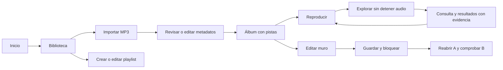

# Pantallas y flujos de EchoBeats

P02 · 12 de noviembre de 2026. Wireframes de baja fidelidad, sin implementación.
La composición es funcional; colores, tipografía e identidad visual final se
refinarán durante la interfaz sin alterar los recorridos del [alcance](ALCANCE_MVP.md).
Ver también [decisiones](DECISIONES.md) y [API](CONTRATO_API.md).

## 1. Estructura compartida y rutas

| Ruta de interfaz | Vista | Acción principal |
| --- | --- | --- |
| `/` | Inicio | Ir a biblioteca o explorar. |
| `/biblioteca` | Álbumes, canciones y playlists | Importar y buscar. |
| `/albumes/:album_id` | Información, pistas y muro | Escuchar y decorar. |
| `/playlists/:playlist_id` | Playlist editable | Gestionar orden, imagen y reproducción. |
| `/explorar` | Consulta semántica y resultados | Buscar por sensaciones. |

No hay página de login. Configuración local mínima se presenta en un panel
desde la navegación: estado de conexión, límites, movimiento reducido y datos
enviados a IA. Nunca muestra ni permite recuperar claves de API del servidor.

Todas las rutas comparten cabecera y reproductor. Solo cambia el contenido
central. La barra inferior reserva su propio espacio en el layout; no flota
encima de botones, tablas o lienzo. Audio comienza tras una acción del usuario.

## 2. Inicio

```text
┌────────────────────────────────────────────────────────────┐
│ EchoBeats    Inicio   Biblioteca   Explorar    Configuración│
├────────────────────────────────────────────────────────────┤
│                     Tu música, tu espacio                 │
│       [ Abrir mi biblioteca ]     [ Explorar con IA ]       │
│                                                            │
│  Biblioteca propia    Muros por álbum    Nuevas conexiones  │
│  [Importar música]     [Ir a álbumes]     [Cómo funciona]    │
├────────────────────────────────────────────────────────────┤
│ Sin reproducción · Selecciona una canción en tu biblioteca │
└────────────────────────────────────────────────────────────┘
```

«Importar» abre el mismo diálogo de biblioteca. «Cómo funciona» explica que las
sugerencias proceden de la colección importada. Si ya suena música, la barra
muestra su estado actual sin iniciar otra pista al volver al inicio.

## 3. Biblioteca e importación

```text
┌────────────────────────────────────────────────────────────┐
│ EchoBeats    Inicio   Biblioteca   Explorar    Configuración│
├────────────────────────────────────────────────────────────┤
│ Mi biblioteca             [Importar MP3] [Crear playlist]  │
│ [ Buscar por canción, artista o álbum                    ]│
│ [Álbumes] [Canciones] [Playlists]                           │
│                                                            │
│ ┌──────────┐ ┌──────────┐ ┌──────────┐                     │
│ │ Portada A│ │ Portada B│ │ Portada C│    [Más resultados]  │
│ │ Álbum A  │ │ Álbum B  │ │ Álbum C  │                     │
│ └──────────┘ └──────────┘ └──────────┘                     │
│ Playlists:    (vinilo 1)      (vinilo 2)    [Editar]        │
├────────────────────────────────────────────────────────────┤
│ Portada · Pista activa · Artista    [◀] [▶/Ⅱ] [▶]           │
│ 00:35 ─────────●──────────────── 03:20     Volumen [────]  │
└────────────────────────────────────────────────────────────┘

Diálogo de importación
┌──────────────────────────────────────────┐
│ Importar música MP3                      │
│ [Seleccionar archivos]   Límites visibles│
│ pista1.mp3   Importado  [Ver canción]     │
│ copia.mp3    Ya existe  [Ver original]    │
│ texto.mp3    No es audio compatible       │
│                          [Cerrar]        │
└──────────────────────────────────────────┘
```

Durante la carga se muestra progreso de la solicitud y, al recibir respuesta,
resultado por archivo. No se muestra un porcentaje inventado de análisis IA.
El duplicado enlaza a la pista existente. Un fallo de lote conserva la selección
para reintentar; la deduplicación evita duplicar los archivos ya recibidos.
Editar metadatos abre formulario de título, artistas y asignación a álbum
existente/nuevo. Muestra procedencia y marca cambios pendientes hasta confirmar.

## 4. Álbum, muro y reproductor

```text
┌────────────────────────────────────────────────────────────┐
│ EchoBeats    Inicio   Biblioteca   Explorar    Configuración│
├─────────────────┬──────────────────────────────────────────┤
│ [Portada]       │ Álbum A       [Editar pared / Bloquear] │
│ Álbum A         │ Estado: Guardado                         │
│ Artista         ├──────────────────────────────────────────┤
│ [Editar datos]  │                                          │
│                 │  ÁREA DECORABLE · proporción 1000 × 700 │
│ Pistas          │       [Póster]           [Sticker]        │
│ 1. Pista uno ▶  │                                          │
│ 2. Pista dos    │                 [GIF]                    │
│                 │                                          │
│                 ├──────────────────────────────────────────┤
│                 │ Solo al editar: Fondo · Añadir · Objeto  │
│                 │ X/Y · Tamaño · Giro · Orden · Eliminar   │
│                 │ [Guardar ahora] [Restablecer]             │
├─────────────────┴──────────────────────────────────────────┤
│ Sonando: pista uno de A      [◀] [▶/Ⅱ] [▶]   Tiempo/volumen │
└────────────────────────────────────────────────────────────┘
```

El lienzo excluye cabecera, herramientas, lista y reproductor. Los objetos nunca
se posicionan respecto a esas zonas. En bloqueo se ocultan tiradores y no se
interceptan gestos. Seleccionar un objeto habilita arrastre, redimensionado y giro,
además de campos numéricos para teclado. Escape cancela el gesto actual y devuelve
su transformación previa; no descarta cambios ya guardados.

La pared arranca bloqueada al entrar. Desbloquear no cambia el audio. El fondo
de color es del muro; portada y datos del álbum son recursos diferentes.
Eliminar objeto lo quita de la composición, sin borrar el archivo compartido.
Restablecer pide confirmar que se retirarán fondo/objetos personalizados del
álbum actual. Si falla el guardado se conserva el borrador y aparece «Reintentar».

Estados de persistencia visibles: Sin cambios / Cambios pendientes / Guardando /
Guardado / No se pudo guardar / Diseño cambiado en otra pestaña. Bloquear con
cambios intenta guardar; si falla, mantiene el borrador y el aviso. Navegar con
pendientes ofrece «Esperar o reintentar», «Descartar cambios» o «Permanecer».
No se asume que cerrar el navegador terminará una petición pendiente.

Actualización P13: panel de álbum/pistas y lienzo proporcionales implementados,
con apilado en ventanas pequeñas. Se renderiza la composición guardada; editar
habilita color y Guardar fondo, y bloquear confirma el color pendiente. Objetos
inmóviles en este incremento; gestos/herramientas se añaden en P14/P15. Se
advierten pendientes al salir y se conserva borrador ante error; coordinación
completa y restablecimiento desde interfaz siguen en P16. Ver VALIDACION_P13.md.

## 5. Playlist

```text
┌────────────────────────────────────────────────────────────┐
│ ← Biblioteca       Mi playlist       [Renombrar]            │
│ [Vinilo/imagen]    [Cambiar imagen] [Vinilo | Imagen]       │
│ [Reproducir]       [Añadir canciones]                      │
│ 1. Pista A   [Subir] [Bajar] [Quitar]                      │
│ 2. Pista B   [Subir] [Bajar] [Quitar]                      │
│                                            [Guardar]      │
├────────────────────────────────────────────────────────────┤
│ Reproductor compartido                                    │
└────────────────────────────────────────────────────────────┘
```

No tiene muro propio. Quitar una pista de la playlist no la elimina de la
biblioteca. Reordenar dispone de botones, aunque se añada arrastre. Se admiten
listas vacías; Reproducir queda deshabilitado hasta que haya pistas disponibles.

## 6. Explorar con IA

```text
┌────────────────────────────────────────────────────────────┐
│ EchoBeats    Inicio   Biblioteca   Explorar    Configuración│
├────────────────────────────────────────────────────────────┤
│ ¿Cómo quieres que suene este momento?                      │
│ [ Algo tranquilo, electrónico y nostálgico               ] │
│ [Buscar en mi música]                                      │
│ Se consultan descripciones de tu biblioteca. [Ver detalles]│
│                                                            │
│ [Portada] Canción A · Artista                   [Escuchar]│
│ Coincide por sintetizadores suaves y energía baja.         │
│ [Ver ficha y procedencia]                                  │
│                                                            │
│ [Portada] Canción B · Artista                   [Escuchar]│
│ Razón sustentada en la descripción registrada.             │
├────────────────────────────────────────────────────────────┤
│ Reproductor compartido                                    │
└────────────────────────────────────────────────────────────┘
```

No mostrar una distancia como porcentaje de confianza. «Ver ficha» distingue
metadatos y descripción manual/inferida. Si solo falla la explicación, se muestra
el resultado recuperado con una razón derivada de su ficha y aviso de alternativa.
Si falla embedding/recuperación, se informa error y se permite reintentar, sin
fabricar recomendaciones. Las búsquedas posteriores invalidan respuestas anteriores.

## 7. Estados y adaptación

| Vista | Vacío | Carga | Error / recuperación |
| --- | --- | --- | --- |
| Inicio | Biblioteca aún no importada; CTA Importar. | Navegación sigue disponible. | Aviso de backend; reintentar. |
| Biblioteca | Sin música o sin coincidencias son estados distintos. | Esqueletos sin fingir portadas reales; mantener consulta. | Mensaje con reintento; conservar selección del lote. |
| Álbum | Álbum sin pistas: permitir decorar, deshabilitar reproducir. | Reservar lienzo y panel; audio actual continúa. | 404 ofrece biblioteca; fallo de muro no borra composición anterior. |
| Playlist | Añadir canciones; sin muro. | Deshabilitar envíos repetidos. | Conservar formulario/borrador; resolver revisión en conflicto. |
| Explorar | Sin biblioteca, sin fichas, sin indexar y sin coincidencias se distinguen. | «Buscando en tu música»; no bloquear reproductor. | Cuota, servicio o validación con mensaje útil y alternativa cuando exista. |

**Escritorio (desde 1024 px):** cabecera horizontal, panel de pistas de unos
280 px y lienzo en el espacio restante. **Intermedio (768–1023 px):** panel
plegable; el lienzo sigue manteniendo proporción. **Estrecho (desde 360 px):**
cabecera compacta con menú y pestañas «Pistas / Pared»; no se apilan objetos sobre
controles. Herramientas en panel debajo del lienzo y reproductor en dos filas.

```text
┌──────────────────────────┐
│ EchoBeats          [Menú]│
│ Álbum A [Pistas] [Pared] │
│ [Editar]  Guardado       │
│ ┌──────────────────────┐ │
│ │ lienzo proporcional  │ │
│ │ objetos escalados    │ │
│ └──────────────────────┘ │
│ Fondo · Objeto · Giro    │
├──────────────────────────┤
│ Título · Artista  [▶/Ⅱ]  │
│ Tiempo/progreso · Volumen│
└──────────────────────────┘
```

En pantalla estrecha, campos numéricos permiten editar sin exigir precisión de
arrastre. El lienzo se adapta por escala, no por redistribución de cada objeto.
Con movimiento reducido, GIF se muestra como imagen estática usando un fotograma
generado al importar; el recurso original se conserva. No habrá animaciones
automáticas decorativas adicionales por defecto.

## 8. Recorrido de comprobación del diseño



Revisión de P02: cada acción tiene vista y respuesta definida; álbum y playlist
se distinguen; el lienzo no incluye controles fijos. En P08/P13 se deberá verificar
el diseño en navegador con teclado y en anchos 360, 768 y 1280 px. Los wireframes
no constituyen todavía una prueba de usabilidad ni un prototipo ejecutable.
