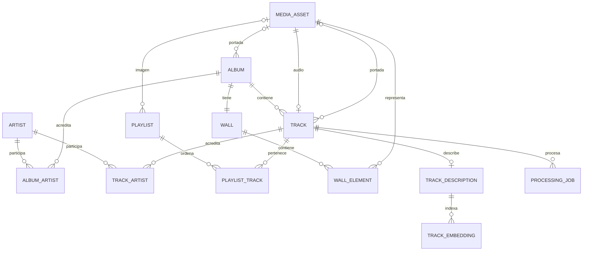

# Modelo inicial de datos de EchoBeats

P02 · 12 de noviembre de 2026. P05/P06 implementan catálogo y recursos; P07
añade procedencia de álbum, agrupación de importación y portada individual;
P12 añade muros/elementos; preferencias e IA siguen siendo diseño para migraciones posteriores.
Complementa [decisiones](DECISIONES.md) y [contrato API](CONTRATO_API.md).

## 1. Convenciones

IDs UUID generados por el servidor; marcas de tiempo con zona, almacenadas en
UTC y serializadas ISO 8601. Nombres internos de campos en inglés y `snake_case`;
etiquetas de interfaz en español. Campos de texto editables se recortan; cadenas
vacías no sustituyen a un valor válido. No hay tabla de usuarios para el MVP local.

Los campos enumerados son el mínimo inicial. Relaciones y restricciones se
aplican en BD y validación de API, no solo en componentes de interfaz.
Estado actual: SQLAlchemy Core en `backend/app/models/catalog.py` y migración
`0002_catalog` y `0003_metadata`. Hay extracción local de etiquetas;
los muros se incorporan con P12.

O06 añade `0004_audio_formats`: amplía la restricción de storage_key para WAV,
FLAC, Ogg y Opus, sin columnas nuevas ni cambios en los medios existentes.
El MIME ya persistido en media_asset se expone como audio_mime_type de pista.

P11 implementa servicios de playlists sobre playlist/playlist_track ya existentes:
reemplazo transaccional de secuencia, bloqueo de fila y revisión ETag, sin migración.
No cambia pertenencia de pistas a álbumes ni elimina medios.

P12 implementa `wall` y `wall_element` en `0005_album_walls`: backfill de todos
los álbumes y creación de muro en la transacción de álbum nuevo. Fondo #242038,
formato/revisión 1; relaciones RESTRICT. El esquema limita valores escalares;
API valida límites rotados, máximo 30 elementos y compatibilidad de recursos.
Ver VALIDACION_P12.md. El editor visual se construye desde P13.

## 2. Entidades y relaciones



La creación de un álbum y su muro inicial ocurre en una transacción. El esquema
impone `UNIQUE(wall.album_id)`; la creación transaccional garantiza que ningún
álbum visible quede sin muro. Un artista puede participar en varias pistas o
álbumes, con orden de crédito explícito.

| Entidad | Campos principales | Reglas |
| --- | --- | --- |
| `media_asset` | id, kind, storage_key, sha256, original_name, mime_type, byte_size, width_px, height_px, frame_count, static_preview_id, created_at | `storage_key` única; tamaño > 0; tipo audio/imagen/GIF/portada. Dimensiones aplican a visuales. Preview estático opcional para GIF, referencia a otro asset sin ciclos. No exponer storage_key. |
| `artist` | id, name, normalized_name | Nombre no vacío; normalized_name única para deduplicación local de etiquetas tras recorte/casefold. No afirmar identificación externa. |
| `album` | id, title, cover_asset_id, system_key, import_key, metadata_sources, revision, created_at, updated_at | Título no vacío; system_key única para el desconocido; import_key única y opcional, conserva la agrupación original al corregir nombres. revision inicia en 1. Título/artista no son identidad única. |
| `album_artist` | album_id, artist_id, position | PK compuesta; orden no negativo, único por álbum. |
| `track` | id, audio_asset_id, content_sha256, album_id, cover_asset_id, title, duration_ms, track_number, metadata_sources, revision, created_at, updated_at | Asset de audio y hash de bytes únicos; álbum obligatorio; portada propia opcional; duración positiva; número opcional positivo. revision inicia en 1. |
| `track_artist` | track_id, artist_id, position | PK compuesta; orden único por pista. Artista desconocido puede representarse como lista vacía y etiqueta visual provisional. |
| `playlist` | id, name, appearance, image_asset_id, revision, created_at, updated_at | appearance: `vinyl` o `image`; nombre obligatorio; imagen opcional con alternativa predeterminada. revision inicia en 1. |
| `playlist_track` | playlist_id, track_id, position | Una pista aparece como máximo una vez por lista; position única por lista. Guardar secuencia completa normaliza posiciones a 0..n−1 en transacción. |
| `wall` | id, album_id, schema_version, revision, background_color, created_at, updated_at | Un muro por álbum; formato 1; revision inicia en 1; color hexadecimal `#RRGGBB`. |
| `wall_element` | id, wall_id, asset_id, kind, cx, cy, width, height, rotation_deg, z_index | UUID estable; tipo poster/sticker/image/gif; asset compatible. Transformaciones finitas y validadas según sección 4. |
| `track_description` | id, track_id, version, text, features, source, source_details, updated_at | Una ficha actual por pista; versión creciente; fuente manual/verified/model; features solo contiene atributos con evidencia. Guardar cambios invalida embeddings previos. |
| `track_embedding` | id, description_id, description_version, model_key, vector, created_at | model_key identifica proveedor/modelo/configuración/dimensiones; unicidad por ficha/versión/model_key. Dimensión vectorial se fija en P21. |
| `processing_job` | id, track_id, operation, input_version, model_key, status, attempts, error_code, created_at, started_at, finished_at | operation inicialmente index_description; estado pending/processing/completed/error/stale. No almacena credenciales ni audio en payload. |

`metadata_sources` es JSON de procedencia por campo, con valores como file/manual/
fallback. `features` guarda atributos opcionales y evidencia: por ejemplo
instrumentos, energía y atmósfera. No se rellena un valor desconocido con una
suposición. Las fuentes model identifican modelo y fecha sin convertir inferencia
en dato verificado. La duración se obtiene del audio, no de una predicción del LLM.

## 3. Biblioteca y metadatos

- Guardar el archivo original una vez; una misma pista puede estar en varias
  playlists. Cambiar la lista no cambia `track.album_id`.
- Importación sin título: usar nombre base del archivo como provisional y
  registrar fallback. Sin álbum: asignar al álbum de sistema «Sin álbum».
- Importación con álbum: resolver por título normalizado y créditos de artista
  de álbum cuando estén disponibles; no mezclar automáticamente álbumes homónimos
  con créditos diferentes. Si la identidad es ambigua, usar «Sin álbum» y permitir
  asignación manual. No consultar internet para completar identidad en el MVP.
- Crear álbum manualmente devuelve un ID nuevo; asignar pista usa ese ID.
  Cambiar los metadatos de una pista no renombra álbumes compartidos por otras.
- Mantener el álbum desconocido estable; puede tener su propio muro.
- Las correcciones manuales no se sustituyen al reintentar extracción. Los datos
  afectados por edición invalidan fichas derivadas cuando su contenido dependa de
  ellos; una ficha manual no se reescribe automáticamente.

## 4. Coordenadas y límites del muro

Referencia fija W=1000, H=700. `cx/cy` expresan el centro y `width/height` el tamaño
en fracciones de W/H. El ancho y alto permanecen entre 0.03 y 0.60. Normalizar
`rotation_deg` al intervalo [−180, 180). Valores NaN o infinitos se rechazan.
`z_index` es un entero de 0 a 29; ordenar por z_index y UUID resuelve empates.

Para validar un rectángulo girado, convertir a unidades del lienzo:

```text
w = width × W; h = height × H; θ = rotation_deg en radianes
bx = (|w cos θ| + |h sin θ|) / 2
by = (|w sin θ| + |h cos θ|) / 2
bx ≤ cx × W ≤ W − bx
by ≤ cy × H ≤ H − by
```

No basta con limitar el centro a [0,1]. Si una transformación no cabe, el cliente
la limita o conserva la última válida; el servidor devuelve error de validación
en vez de corregir silenciosamente. P12 fija tolerancia de `1e-7` unidades del lienzo de referencia; P15 debe
reutilizar ese valor en el cliente para evitar diferencias por redondeo.

Guardar fondo y todos los elementos en una transacción con revisión esperada.
Actualizar solo si coincide `revision`; incrementar una vez por composición
aceptada, incluso al restablecer. Elementos omitidos se retiran de ese muro.
UUID de elemento existente en otro muro se rechaza; no se reasigna. Los recursos
compartidos se mantienen. Dos pestañas no deben sobrescribirse sin advertencia.

## 5. Trabajos y embeddings

La pista se puede reproducir aunque no tenga descripción o vector. El estado
de indexación se deriva de ficha, embedding compatible y trabajo más reciente,
sin convertir errores de IA en errores de biblioteca.

Al encolar se captura versión y model_key. Solo un trabajo activo por
pista/operación/versión/model_key, protegido en BD. Tras terminar, comparar versión
actual antes de publicar vector; si cambió, marcar stale. El usuario puede iniciar
otro trabajo con la ficha actual. Cada adquisición es atómica, sin transacciones
abiertas durante llamadas externas. Reinicio deja processing como error recuperable.

Solo consultar embeddings de la versión actual y del model_key activo. Al cambiar
modelo se requiere migración/configuración de dimensiones y reindexación explícita;
no mezclar vectores antiguos. Para el catálogo pequeño, comenzar con búsqueda
exacta y justificar índices aproximados con mediciones posteriores.

## 6. Etapas de creación y conservación

P05 crea catálogo, recursos y playlists; P12 añade muros/elementos; P18 trabajos;
P19 fichas; P21 embeddings. Crear el muro al crear un álbum se incorpora al
servicio de álbumes en P12, incluyendo migración para álbumes preexistentes.
P24 añade favoritos si se habilita; historial y conversaciones no se crean ahora.

No implementar DELETE de pistas/álbumes en el MVP inicial. Relaciones a archivos
compartidos se protegen con RESTRICT; eliminación de playlist retira sus vínculos
solo si más adelante se incorpora esa acción. Reemplazo de elementos usa borrado
transaccional de sus filas, no cascadas a assets. Un respaldo completo comprende
BD y MEDIA_ROOT juntos; exportar solo vectores no recupera la biblioteca.
